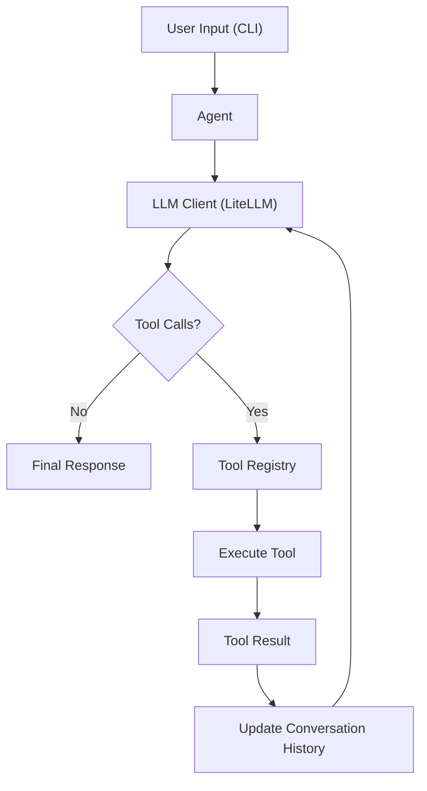

# 🤖 CLI Coding Support Agent

An AI-powered command-line coding assistant that interacts with your local development environment using LLM-powered function calling. It can explore project structures, understand existing code, create and modify files, and execute shell commands with user approval.

The agent follows an iterative tool-calling workflow, allowing it to reason about a coding task, select appropriate tools, observe their results, and continue until the task is completed.

**Built with:** Python · LiteLLM · Gemini · Function Calling

---

## ✨ Features

- **Project Exploration:** Understand the current working directory and navigate files and folders.
- **File Operations:** Read, create, write, and modify source files.
- **Targeted Code Editing:** Replace or insert code at specific locations without rewriting entire files.
- **Shell Command Execution:** Execute terminal commands with explicit user approval.
- **LLM-Powered Tool Calling:** Dynamically select and invoke tools based on the user's coding request.
- **Conversation Context:** Maintain conversation history across interactions.
- **Iterative Agent Execution:** Execute multiple tool calls in sequence to solve complex coding tasks.
- **Configurable LLM:** Use LiteLLM to configure the underlying language model.

## 🏗️ Architecture

The agent follows an iterative tool-calling execution loop:



### Agent Execution Flow

1. User submits a coding request through the CLI.
2. The agent sends the conversation context and available tool schemas to the LLM.
3. The LLM decides whether to respond directly or invoke one or more tools.
4. The agent executes the requested tools and captures their outputs.
5. Tool results are appended to the conversation history.
6. The updated context is sent back to the LLM for further reasoning.
7. The process continues until a final response is generated or the iteration limit is reached.

## 🛠️ Available Tools

| Tool | Description |
|---|---|
| `get_current_directory` | Retrieves the current working directory. |
| `list_files` | Lists files and directories. |
| `read_file` | Reads file contents. |
| `create_file` | Creates a new file. |
| `write_file` | Writes or overwrites file contents. |
| `edit_file` | Performs targeted text replacement or insertion. |
| `run_shell` | Executes shell commands after user approval. |

## 📁 Project Structure

```text
my-cli-coding-support-agent/
│
├── main.py          # CLI entry point and user interaction
├── agent.py         # Agent orchestration and tool execution loop
├── llm_client.py    # LLM integration through LiteLLM
├── prompts.py       # System instructions for the coding agent
├── schemas.py       # Function/tool calling schemas
├── tools.py         # File system and shell execution tools
├── requirements.txt # Python dependencies
├── .env             # Environment configuration
└── .gitignore
```

## 🚀 Getting Started

### Prerequisites

- Python installed on your system.
- An API key for your configured LLM provider (Gemini by default).

### 1. Clone the repository

```bash
git clone https://github.com/Kiran-velan/my-cli-coding-support-agent.git

cd my-cli-coding-support-agent
```

### 2. Create a virtual environment

```bash
python -m venv venv
```

Activate it:

**Windows**
```bash
venv\Scripts\activate
```

**Linux / macOS**
```bash
source venv/bin/activate
```

### 3. Install dependencies

```bash
pip install -r requirements.txt
```

### 4. Configure environment variables

Create a `.env` file in the project root:

```env
GEMINI_API_KEY=your_gemini_api_key
MODEL=gemini/gemini-2.5-flash
```

The `MODEL` variable is optional. If omitted, the agent defaults to `gemini/gemini-2.5-flash`.

### 5. Run the agent

```bash
python main.py
```

## 💻 Usage

Once started, interact with the coding assistant directly through your terminal.

Example prompts:

```text
> Explain the structure of this project.

> Find the file responsible for user authentication.

> Read main.py and explain how the application works.

> Create a new Python module for handling database connections.

> Refactor the existing function to improve readability.

> Run the test suite and explain any failures.
```

When the agent requests shell command execution, it displays the proposed command and asks for explicit permission.

```text
The assistant wants to run:

python -m pytest

Allow? (y/n):
```

## ⚙️ Configuration & Execution Limits

The agent includes configurable execution limits to control conversation context and tool orchestration.

| Configuration | Default |
|---|---:|
| Maximum conversation history | 25 messages |
| Maximum tool execution iterations | 10 |
| Default LLM | Gemini 2.5 Flash |

These limits are defined in the `Agent` class and can be adjusted as needed.

## 🔒 Safety Considerations

- Shell commands require explicit user approval before execution.
- The agent is instructed to inspect files before modifying them.
- Targeted edits validate that the requested text occurs exactly once, avoiding ambiguous modifications.
- API credentials should be stored in environment variables and never committed to version control.

**Note:** Shell commands execute with the permissions of the current operating-system user. Review commands carefully before approving them.

## 🧰 Tech Stack

- **Language:** Python
- **LLM Integration:** LiteLLM
- **Default Model:** Google Gemini 2.5 Flash
- **Agent Architecture:** Function Calling / Tool Calling
- **Environment Management:** python-dotenv
- **Execution:** Python subprocess

## 🔮 Future Improvements

Potential extensions for the project:

- Git integration for reviewing and managing code changes.
- Project-aware context and codebase indexing.
- Test execution and automated debugging workflows.
- Diff previews and rollback support for file modifications.
- Persistent conversation sessions.
- Additional LLM providers and configurable agent models.

## 👨‍💻 Author

**Kiran S**

- GitHub: [Kiran-velan](https://github.com/Kiran-velan)

---

*An experiment in building autonomous coding assistants using LLM-powered tool orchestration.*
